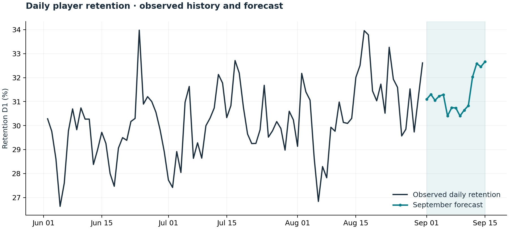
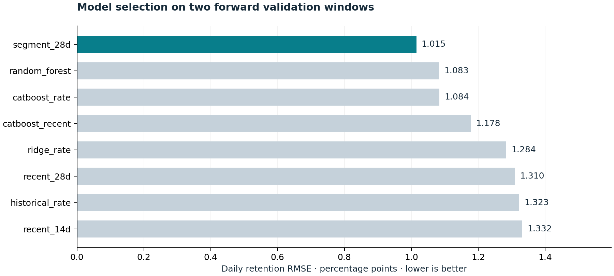
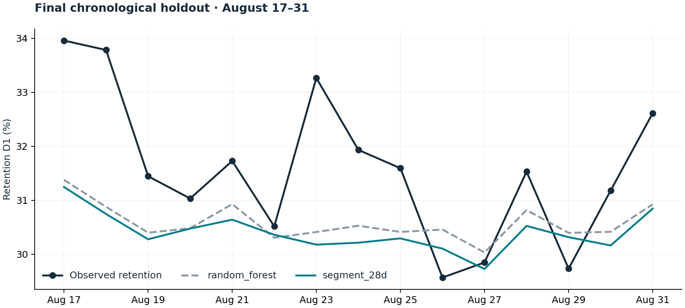

# Daily Player Retention Forecasting

**Nordeus JobFair 2022 · Top Eleven · Data science case study**

Forecast the percentage of newly registered players who return the next day.
This project covers the complete workflow: cohort data validation, chronological
backtesting, model comparison, daily aggregation, and submission generation.

[Notebook](NordeusChallenge2022.ipynb) · [Evaluation results](reports/RESULTS.md) · [Submission](retention_d1_predictions.csv) · [Source code](src/jobfair)



## Results

Eight approaches are compared using daily retention RMSE, measured in **percentage
points**. Model selection uses two forward validation windows; a separate final
window assesses the selected model without further tuning.

| Model | Development RMSE ↓ | Final holdout RMSE ↓ |
| --- | ---: | ---: |
| Historical retention baseline | 1.3230 | 2.1300 |
| Recent 28-day baseline | 1.3097 | 2.0770 |
| Random forest reference | 1.0829 | **1.5038** |
| Selected segment model | **1.0152** | 1.6224 |

The segment model improves development RMSE by **6.2%** against the forest and
holdout RMSE by **23.8%** against the historical baseline. It does **not** outperform
the forest on the final window. That reversal, together with underprediction in
late August, highlights the uncertainty of model selection on a short history.
The published submission follows the development-selected model.

These are local chronological validation results. September targets are hidden;
no official leaderboard score or September accuracy is claimed.



## The forecasting problem

Each row describes a registration cohort: acquisition channel, previous playing
history, device characteristics, registrations, and next-day returned players.
The dataset contains **342,332 rows across 106 dates**. Labels are available from
June 2 through August 31; September's `returned` values are zero placeholders.

The target is a **daily** KPI:

```text
Daily retention D1 (%) = 100 × sum(predicted returned players) / sum(registrations)
```

Counts are aggregated before division. Averaging row-level percentages would
give small and large cohorts the same weight and answer a different question.
The forecast assumes the registration covariates and cohort sizes supplied by
the challenge are available; it does not forecast those inputs themselves.

## Approach

- **Rate baselines:** historical, trailing 14-day, and trailing 28-day retention.
- **Segment model:** trailing 28-day rates grouped by registration type, previous
  playing history, and acquisition channel. A 100-registration prior shrinks
  sparse groups toward the overall recent rate; unseen groups use that prior.
- **Random forest:** 50 trees, depth 10, and minimum leaf size 4, predicting returned
  counts. Sparse one-hot encoding handles high-cardinality device categories.
- **Weighted ridge:** regularized cohort-rate regression with rare-category
  pooling, training-fitted imputation, and numerical scaling.
- **CatBoost:** categorical cohort-rate models, with and without 28-day recency
  weighting. Registration-weighted [cross-entropy](https://catboost.ai/docs/en/concepts/loss-functions-classification)
  accounts for the different cohort sizes.

Features include the supplied registration/device attributes, day of week, and
elapsed days. `returned` is never a feature. All learned preprocessing is fitted
on training data; prediction counts are bounded by cohort registrations.

| Stage | Training through | Evaluation dates | Purpose |
| --- | --- | --- | --- |
| Development 1 | July 17 | July 18–August 1 | Candidate comparison |
| Development 2 | August 1 | August 2–16 | Candidate comparison |
| Final holdout | August 16 | August 17–31 | Assess the frozen selection |
| September forecast | August 31 | September 1–15 | Submission |

All dates refer to 2022. Validation holds out entire days. Selection uses pooled
daily RMSE across the two development windows, not random row splits. Model
settings are fixed in [models.py](src/jobfair/models.py); the final window is not
used for early stopping or hyperparameter tuning.



## Run locally

Use Python **3.9–3.12**. The recorded run uses Python 3.9 on CPU; no GPU, credentials,
or external API is required. Run commands from the repository root.

```sh
git clone https://github.com/stefisha/JobFairChallenge2022.git
cd JobFairChallenge2022
python -m venv .venv
source .venv/bin/activate
python -m pip install --upgrade pip
python -m pip install -e .

# Reproduce model selection, final validation, forecasts, and figures.
jobfair run --threads 4

# Verify published metrics and submission files without retraining.
jobfair check
python -m unittest discover -s tests -v
```

On Windows, activate with `.venv\Scripts\activate`. `python -m jobfair` can replace
`jobfair` in every command. Use `--data /path/to/training.csv` for another copy of
the supplied dataset. To recreate the recorded dependency environment, install
`requirements-lock.txt` before `python -m pip install --no-deps -e .`.

Individual stages are also available:

```sh
jobfair select
jobfair holdout
jobfair forecast

# Optional notebook interface.
python -m pip install -e ".[notebook]"
jupyter lab NordeusChallenge2022.ipynb
```

## Submission dates

The brief asks for dates **after August 31** and also specifies **16 rows**.
September 1–15 contains 15 days, while August 31 has observed labels. Both
interpretations are available:

| File | Dates | Training labels used |
| --- | --- | --- |
| [retention_d1_predictions.csv](retention_d1_predictions.csv) | September 1–15, 15 rows | Through August 31 |
| [reports/submission_16_days.csv](reports/submission_16_days.csv) | August 31–September 15, 16 rows | Through August 30 |

Both files contain one row per day, ISO dates, and percentages with four decimal
places. The 16-row variant forecasts August 31 without using its observed target:

```sh
jobfair forecast --forecast-start 2022-08-31 --output reports/submission_16_days.csv
```

## Repository guide

```text
NordeusChallenge2022.ipynb     Executed analysis and interpretation
src/jobfair/                  Data contracts, models, evaluation, and CLI
tests/                        Synthetic regression tests
reports/                      Fold scores, daily predictions, manifests, and figures
retention_d1_predictions.csv   Daily September forecast
Challenge/                    Supplied challenge brief and dataset
```

The dataset and brief are provided as challenge materials; inclusion does not
assert ownership or a separate redistribution license. Dataset SHA-256 and package
versions are recorded in [run_manifest.json](reports/run_manifest.json).

## Limitations and next steps

The labeled history spans only 91 days. One 15-day final window cannot establish
stable superiority, and late-August underprediction suggests changing retention
levels. A longer rolling evaluation, cohort-specific drift monitoring, calibrated
forecast intervals, and additional labeled history would strengthen the evidence.
With the available data, the forest remains an important competing reference.

**Author:** [Stefan Veličković](https://github.com/stefisha)
